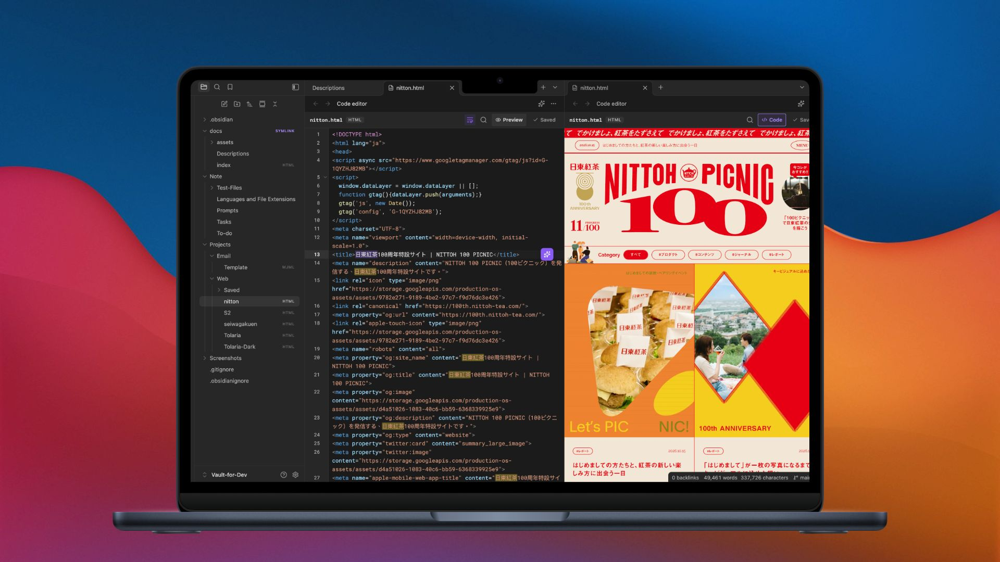

# Vault Code

<h3 align="center" style="color: #3b82f6; margin: 1rem 0; "><strong>Vault Code turns Obsidian into a workspace for notes, code, and files.</strong></h3>

**Vault Code** plugs straight into Obsidian's file explorer and editor. Reveal hidden files, create any file type, plan on Kanban boards made of plain folders, and write code in a real code editor. Preview web pages, diagrams, and data, or pair up with AI agents, all inside Obsidian.

**Vault Code** follows your Obsidian display language and supports English, 繁體中文, 简体中文, 日本語, 한국어, Español, Français, Italiano, Deutsch, and Русский.

---

## ⚡ Features at a Glance

**File explorer**
* **Hidden files & folders**: Reveal dotfiles, dotfolders, and extensionless files.
* **File creation & renaming**: Create any file type or nested path; rename files and extensions.
* **External folders (Desktop)**: Add folders from your disk by symlink.
* **Ignore rules**: Keep the explorer tidy with `.obsidianignore` and `.gitignore`.
* **Unlinked media**: Find images, audio, and video no note links to, and move them to trash.
* **Recent files**: A sidebar tab of everything you touched lately, newest first.
* **Find in files**: Search the text of every file, code and dotfiles included, and jump straight to the match.

**Kanban**
* **Folder boards**: Any folder becomes a board: subfolders are columns, notes are cards.
* **Search, tags & icons**: Find cards fast, filter by tags like Trello labels, and see your Iconize icons.

**Code editor**
* **Editing tools**: Syntax highlighting, line numbers, folding, and familiar editing shortcuts.
* **Markdown source editing**: Switch between Obsidian's note view and the code editor.
* **Find & replace**: Search across lines with regex, case matching, and whole-word matching.
* **Live preview**: Render web pages, emails, diagrams, data tables, and diffs.
* **Mobile & tablet support**: Edit code and manage files on desktop, tablets, and phones.

**Git** (Desktop only)
* **Git feature**: Review diffs, keep or revert changes, and commit individual files.

**Ask AI** (Desktop only)
* **Notes and code**: Ask about your notes and code, or request edits in the sidebar.
* **Flexible connections**: Use coding CLIs, hosted APIs, or local model servers.

---

## What you can do

### 🗂️ Plan with Kanban boards

Right-click a folder and choose **Open as Kanban**. Subfolders become columns, notes become cards, and the board is never anything but your files.

* **Drag and drop**: Move cards and columns smoothly on desktop, tablet, and phone. Moving a card moves its note.
* **Rich cards**: Each card previews its note: checklists, formatting, code, callouts, cover images, and tag pills. Tick tasks or edit titles and descriptions right on the card. Prefer compact cards? Turn off cover images from the board's gear menu.
* **Search & filter**: Type to find cards, use `#tag` for exact tag matches, or pick tags from the `#` menu.
* **Iconize icons**: With the Iconize plugin, folder and note icons and `:IconName:` shortcodes show up on the board too.
* **Agent-friendly**: Order lives in a small `Board.kanban` file. Notes added or moved by scripts, AI agents, or sync show up right away.

### ✏️ Edit code right where you write notes

Scripts, styles, and config files open right next to your notes.

* **170+ file extensions supported**: Python, JavaScript, TypeScript, Rust, Go, SQL, HTML, CSS, JSON, YAML, and more.
* **Markdown source**: Right-click a `.md` file and choose **Edit in code editor**, or click `</>` in the tab header. Handy for frontmatter, tables, and regex edits.
* **Familiar controls**: Line numbers, bracket matching, code folding, line duplication, commenting, and go-to-line.
* **Feels native**: Built on Obsidian's editor engine, so it wears your theme, font size, and light or dark mode.

### 👁️ See your hidden dotfiles and configs

* Reveal `.gitignore`, `.env`, `.dockerignore`, and `.github/` in the file explorer.
* Open extensionless files such as `Makefile`, `Dockerfile`, `LICENSE`, and `CNAME`.
* Hide `.git`, `node_modules`, and other clutter with ignore rules.

### 🌐 Preview files beside your code

Switch between code and preview with the **Preview** button or **Toggle code / preview** command.

* Render HTML, SVG, and MJML, including linked styles and images.
* View Mermaid diagrams, JSON, CSV/TSV, JSONL/NDJSON, and diff/patch files.
* Edit supported table cells with **Apply** or **Cancel**. Invalid or ambiguous data stays read-only.

### 🔍 Find & replace

Press <kbd>Cmd</kbd> / <kbd>Ctrl</kbd> + <kbd>F</kbd> to search, or <kbd>Cmd</kbd> / <kbd>Ctrl</kbd> + <kbd>H</kbd> to replace.

* Search across lines with a live match count, plus case (`Aa`), whole-word (`\b`), and regex (`.*`) toggles.

### 📂 Create, rename & organize files

Right-click a file or folder in the explorer:

* **New note here**: Create a Markdown note in that folder.
* **New folder here**: Name a folder directly in the explorer.
* **New file here (any extension)**: Create any file type, including dotfiles and nested paths such as `src/components/Button.tsx`.
* **Edit file name and extension...**: Rename files or change their extensions with built-in validation.
* **Add external folder by symlink (Desktop)**: Link any folder on your disk into your vault.
* **Show unlinked media**: Find images, audio, and video no note or canvas links to, and trash them in bulk.

Lost track of what you just worked on? The **Recent files** sidebar tab lists files of any type by last edit or addition, grouped into Today, Yesterday, and earlier. Outside changes show up too; files your ignore rules hide stay hidden.

Need that one line in a config file? **Find in files** (left sidebar, or the *Find in files* command) looks through the text of every visible file, not just notes, with case, whole-word, and regex toggles. Click a result to open the file at that line; select text first and the command searches for it.

### 🌿 Review changes with Git (Desktop)

When your vault is inside a Git repository:

* Compare file contents with the last commit directly in the editor.
* Jump between changes and keep or revert individual hunks.
* See the current branch and changed-file count in the status bar.
* Commit an individual file with a message, or discard its changes.

### ✨ Ask AI (Desktop)

Ask AI about notes and code in the sidebar. Choose a connection in settings:

* **CLI**: Use Claude Code, Codex, Copilot, and other coding agents with their workspace tools. Install and update agents from settings.
* **API**: Bring your own key for OpenAI, Anthropic, Gemini, DeepSeek, Qwen, or another provider. Custom endpoints and model IDs are supported.
* **Local**: Connect Ollama, Atomic Chat, LM Studio, CC Switch, or another compatible server.

Attach notes or selections, pin context, and guide AI responses with a customizable `instructions.md` note in your chat folder. Revisit Markdown chat histories anytime.

### 🛡️ Control editing and file opening

* Single-clicking unsupported files selects them; opening them in your default app on double-click is optional and off by default.
* Disable auto-save to save manually with <kbd>Cmd</kbd> / <kbd>Ctrl</kbd> + <kbd>S</kbd>. A dot `●` marks unsaved changes, and closing an unsaved tab prompts you. **Quitting Obsidian still saves unsaved edits.**
* File management and code editing work on desktop, mobile, and tablets. Git, Ask AI, and adding external folders require desktop Obsidian.

---

## Shortcuts

| Shortcut | Action | Where |
| :--- | :--- | :--- |
| <kbd>Cmd</kbd> / <kbd>Ctrl</kbd> + <kbd>F</kbd> | Find text | Code editor |
| <kbd>Cmd</kbd> / <kbd>Ctrl</kbd> + <kbd>H</kbd> | Find and replace | Code editor |
| <kbd>Ctrl</kbd> + <kbd>G</kbd> | Go to line | Code editor |
| <kbd>Cmd</kbd> / <kbd>Ctrl</kbd> + <kbd>/</kbd> | Toggle line comment | Code editor |
| <kbd>Shift</kbd> + <kbd>Option</kbd> / <kbd>Alt</kbd> + <kbd>A</kbd> | Toggle block comment | Code editor |
| <kbd>Option</kbd> / <kbd>Alt</kbd> + <kbd>↑</kbd> / <kbd>↓</kbd> | Move line | Code editor |
| <kbd>Shift</kbd> + <kbd>Option</kbd> / <kbd>Alt</kbd> + <kbd>↑</kbd> / <kbd>↓</kbd> | Duplicate line | Code editor |
| <kbd>Cmd</kbd> / <kbd>Ctrl</kbd> + <kbd>Shift</kbd> + <kbd>K</kbd> | Delete line | Code editor |
| <kbd>Alt</kbd> + <kbd>Z</kbd> | Toggle line wrapping | Code editor |
| <kbd>Cmd</kbd> / <kbd>Ctrl</kbd> + <kbd>S</kbd> | Save file | Code editor |
| <kbd>Esc</kbd> | Close search or dismiss a popup | Relevant editor or dialog |

Assign custom shortcuts to **Vault Code: Ask AI** or **Vault Code: Toggle code / preview in code editor** in **Settings → Hotkeys**.

---

## Installation

### From Obsidian Community Plugins *(Recommended)*

1. Open **Settings → Community plugins** and turn off **Restricted mode**.
2. Click **Browse** and search for `Vault Code`.
3. Click **Install**, then **Enable**.

### Via BRAT

To test pre-release builds or update directly from GitHub:

1. Install and enable the [BRAT](https://community.obsidian.md/plugins/obsidian42-brat) plugin from Community Plugins.
2. In BRAT settings, click **Add Beta plugin** and enter `SPACESODA/obsidian-vault-code`.

### Manual installation

1. Download `main.js`, `manifest.json`, and `styles.css` from the latest [GitHub Release](https://github.com/SPACESODA/obsidian-vault-code/releases).
2. Create `.obsidian/plugins/vault-code/` inside your vault and copy those three files into it.
3. In Obsidian, open **Settings → Community plugins**, refresh the list, and enable **Vault Code**.

---

## Privacy & Network Disclosure

Vault Code sends no analytics or telemetry. Network activity depends on what you use:

* **Ask AI**: CLI agents contact their configured services. API and local connections send prompts, chat history, and attached note or selection context to your chosen endpoint. A loopback endpoint runs on your device; its server may also route to cloud providers.
* **CLI installation & updates**: Contact the agent's installer or package registry.
* **Live preview**: HTML can run JavaScript and load remote resources. Remote CSS, fonts, images, or scripts may make network requests.
* **External links**: Settings links open in your default browser.

---

## License

Brought to you by **[SPACESODA](https://github.com/SPACESODA)** under the [GNU AGPLv3 License](LICENSE).
